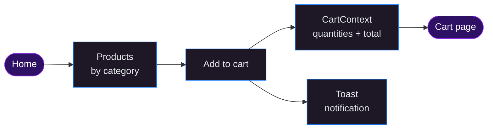

<!-- styled:v2 -->
<div align="center">


**A modern React and TypeScript storefront for tech gadgets and lifestyle electronics, with product browsing, a cart and toast notifications.**

<p>
  
  
  
  
</p>

<p>
  <a href="#how-it-works">How it works</a> ·
  <a href="#features">Features</a> ·
  <a href="#tech-stack">Tech stack</a> ·
  <a href="#project-structure">Project structure</a> ·
  <a href="#getting-started">Getting started</a>
</p>

</div>

---

## Features

- Hero section and featured products on the home page
- Product catalogue across Audio, Smart Home, Computing and Gaming
- Cart built on React Context: add, remove and update quantities with a live total
- Toast notifications for cart actions
- Responsive layout with a shared header and footer
- Client-side routing for the Home, Products and Cart pages

## How it works



## Tech stack

| Area | Tools |
|:--|:--|
| UI | React 19, TypeScript, Lucide icons |
| Routing | React Router 7 |
| State | React Context (cart, toasts) |
| Build | Vite |

## Project structure

```
├── App.tsx
├── components/   # Home/Hero, Layout/Header + Footer, Product/ProductCard + FeaturedProducts
├── context/      # CartContext, ToastContext
├── pages/        # Home, Products, Cart
└── types.ts
```

## Getting started

```bash
npm install
npm run dev
```

---

<div align="center">

**Built by [Ch Muhammad Samiullah](https://github.com/samiullah156-creator)** · AI Automation Engineer and Full-Stack Developer at [Lexvaxa](https://lexvaxa.com)

<a href="https://github.com/samiullah156-creator"></a>
<a href="https://lexvaxa.com/contact"></a>
<a href="https://www.linkedin.com/in/sami-lexvaxa/"></a>

<sub>⭐ Star this repo if you found it useful</sub>

</div>


